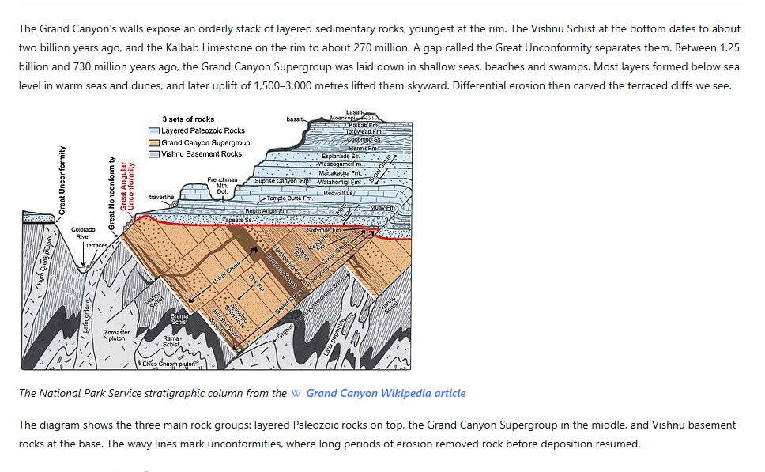
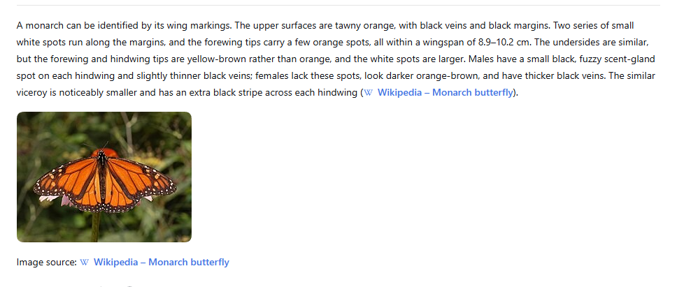
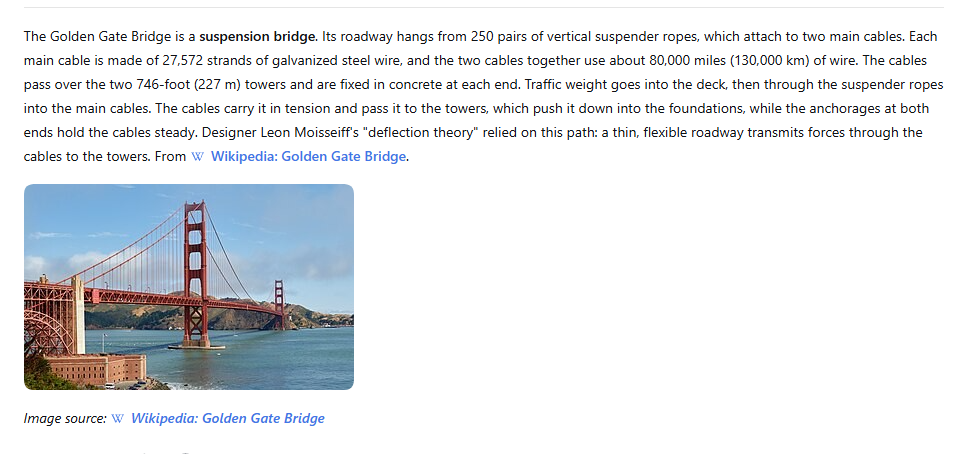

# CiteWeave for DeepSeek Harness

**为 DeepSeek Harness 回答提供网页证据与可追溯的配图。**

[](https://github.com/wavachao/dsh-citeweave/actions/workflows/ci.yml)
[](LICENSE)
[](https://github.com/deepseek-ai/deepseek-harness)

[English](README.md) · [后端部署](docs/backend.md) · [接口与配置](docs/reference.md) · [版本发布](https://github.com/wavachao/dsh-citeweave/releases)

CiteWeave 为 [DeepSeek Harness](https://github.com/deepseek-ai/deepseek-harness) 注册 `citeweave_search` 工具，检索网页证据、描述候选图片并筛选相关配图。Harness 使用这些材料组织最终回答，在正文中展示图片并链接至原始来源页面。

可选的 [12 GB 显卡部署方案](backend/README.md)使用固定版本的 Qwen3.5-9B 社区 AWQ 4-bit 模型，在本地完成辅助查询和视觉描述，排序在 CPU 上执行。Harness 的最终回答仍由原来配置的 DeepSeek 模型生成，无需重新训练。

- 自动联网搜索，或读取最多五个指定网页。
- 根据图片视觉描述与相关性排序选择配图。
- 将图片存入 Harness 原生附件存储，通过现有 Markdown 渲染器显示。
- 在工具结果中保留结构化图片引用，供会话附件导出使用。
- 在 Harness Desktop 与 Web 共用的插件界面中配置后端。
- GPU 后端独立部署，无需修改 Harness 源码。

## 图文回答示例

地质、生物与工程领域的回答示例，图片与解释相邻展示，并保留来源页面引用。

**大峡谷地层**：结合检索到的美国国家公园管理局地质图，解释岩层结构。



**帝王蝶识别**：结合检索到的蝴蝶照片，说明翅膀纹路与识别特征。



**桥梁工程**：结合金门大桥来源照片，解释悬索桥的荷载传递路径。



截图为 Harness Web 的实际回答。嵌入图片保留原始许可证，作者与许可信息见[图片署名](docs/images/README.md)。

## 运行要求

| 组件 | 支持版本或要求 |
| --- | --- |
| DeepSeek Harness | `0.2.1-rc.2` |
| 插件运行环境 | Node.js 24 或更新版本；Harness 附件与文件系统服务 |
| CiteWeave 后端 | 提供证据接口的[固定版本](docs/backend.md)，可由 Harness 主机访问 |
| 后端硬件 | Linux、Python 3.12、NVIDIA GPU；Qwen3.5 vLLM 方案已验证 RTX 3060 12 GB，原本地方案已验证 RTX 4090 D 24 GB |

Harness 仍在持续开发，本插件仅声明兼容上表中的明确版本。安装插件不会同时安装 Python 后端或模型权重。

## 安装

### 1. 启动 CiteWeave 后端

按照[后端部署指南](docs/backend.md)安装提供 `POST /api/evidence` 的固定版本。已有部署也必须具备此接口；CiteWeave 的 `main` 分支目前未提供该接口。

如需在 RTX 3060 12 GB 上本地运行辅助文本与视觉模型，使用 [Qwen3.5 vLLM 指南](backend/README.md)。指南包含固定模型提交、容器镜像、CPU 排序器配置及真实证据接口检查；附带适配补丁只需应用到独立后端副本。

### 2. 安装插件

在 Harness Desktop 或 Web 中打开**插件 → 添加插件**，输入软件包定位符：

```text
github:wavachao/dsh-citeweave#v0.2.0
```

安装到当前使用的配置档。Harness Desktop 与 Web 共用插件管理客户端和配置界面。软件包直接提供可运行的 ES 模块，无需构建，也不执行安装脚本。

命令行和发布包安装见[高级安装](docs/reference.md#advanced-installation)。带版本的发布包及校验和见[版本页面](https://github.com/wavachao/dsh-citeweave/releases/tag/v0.2.0)，安装不依赖 npm 发布。

### 3. 配置连接

打开**插件 → 已安装插件 → CiteWeave**，点击组件的**配置 CiteWeave 图文检索**入口，填写配置：

- **后端地址**（`endpoint`）：例如 `http://127.0.0.1:8765`。
- **访问令牌**（`accessToken`）：后端启用鉴权时，填写工作区令牌。
- **超时**（`timeoutMs`）和**最多图片数**（`maxImages`）：按需调整默认值。

保存后，新工具调用立即使用新配置，无需设置环境变量或重启主机。令牌输入框采用遮罩显示，不回显已保存值；留空保留原令牌，使用**清除已保存令牌**可删除已保存值。若主机已设置 `CITEWEAVE_ACCESS_TOKEN`，清除后仍会回退使用该环境变量。

配置页用于连接已部署的后端，不负责启动 GPU 服务或下载模型。远程后端使用 HTTPS 或 SSH 隧道。图片由 Harness 主机下载，浏览器无需持有后端令牌。

## 使用

直接提出需要配图的问题，例如：

> 解释埃拉托色尼如何测量地球周长，配上相关示意图并注明来源。

> 对比悬索桥与斜拉桥，用照片展示它们的结构差异。

工具描述与提示引导 Harness 在需要图解时调用插件。实际工具选择和最终表述由当前回答模型决定。CiteWeave 返回证据和图片，最终回答由 Harness 生成。

工具支持检索问题、指定来源网页、图片验证和缓存刷新。参数见[工具参考](docs/reference.md#citeweave_search)。

## 配置

| 配置项 | 默认值 | 说明 |
| --- | --- | --- |
| `endpoint` | `CITEWEAVE_ENDPOINT` 或 `http://127.0.0.1:8765` | 后端服务地址。 |
| `accessToken` | `CITEWEAVE_ACCESS_TOKEN` 或空值 | 后端工作区令牌，通过 Bearer 请求头发送。 |
| `timeoutMs` | `180000` | 整次工具调用的超时，单位为毫秒。 |
| `maxImages` | `3` | 单次检索最多返回图片数，范围为 1–8。 |

非空插件配置优先于环境变量。托管部署仍可使用[环境变量和配置补丁](docs/reference.md#advanced-configuration)。

## 运行边界

- 后端需要访问公开网页及配置的搜索服务。网页可用性、图片质量和检索覆盖率取决于来源。
- 未找到合适图片时，工具返回文字证据。单张图片下载失败会作为检索信息返回，其余证据仍可使用。
- 图片会复制到 Harness 附件存储，工具结果保留原生附件引用。最终回答中的 Markdown 路径由当前 Harness 文件系统解析；文件系统提供者必须向渲染器暴露这些文件。在另一台主机导入会话时，可能需要适配路径。
- 后端串行处理 GPU 任务，繁忙时返回 `409`，应等待当前任务结束后重试。首次模型加载可能需要延长超时。
- 问题和指定 URL 会发送到配置的后端；搜索服务和来源网站会收到相应检索请求。数据处理说明见 [SECURITY.md](SECURITY.md)。
- 注明来源不代表取得图片使用许可。检索到的内容保留原有许可证。

## 参与贡献

本地开发、测试、打包与集成检查见 [CONTRIBUTING.md](CONTRIBUTING.md)。可复现的问题请提交至 [GitHub Issues](https://github.com/wavachao/dsh-citeweave/issues)；安全漏洞请按 [SECURITY.md](SECURITY.md) 私下报告。

## 许可证

[MIT](LICENSE)。本项目是基于 [CiteWeave](https://github.com/wavachao/citeweave) 的独立 DeepSeek Harness 集成。Harness、后端模型与检索内容各自保留其许可证。
