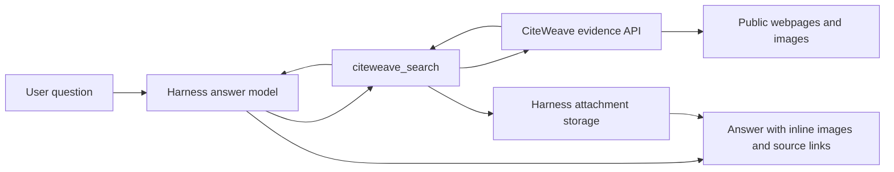

# Plugin reference

[README](../README.md) · [Backend setup](backend.md)

## Configuration

Harness Desktop and Web use the same plugin configuration client. Open **Plugins → Installed plugins → CiteWeave**, then open the component's **Configure CiteWeave** control to edit the backend address, access token, timeout, and image limit. Save to apply the changes to new tool calls immediately. An in-progress call keeps the settings with which it started.

The access-token field is masked and write-only: the saved value is not returned to the page. Leaving it blank preserves the saved token. Use **Clear saved token** to remove it. Form submissions update only changed configuration fields. The page configures a connection; it does not deploy or start the GPU backend.

The package is a native Host plugin bundle with a configuration client: `package.json` declares `dsh.bundle`, and `cordis.patch.yml` inserts the `citeweave` plugin row. The retrieval tool requires the Harness `tools`, `systemPrompt`, `attachments`, and `fs` services.

Backend model selection is independent of the Harness answer model. The optional [Qwen3.5 vLLM profile](../backend/README.md) runs local query assistance and visual descriptions with CPU ranking, while Harness retains its DeepSeek provider. Model-server settings belong to the backend's environment, not this plugin configuration form.

| Field | Type | Default | Meaning |
| --- | --- | --- | --- |
| `endpoint` | string | `CITEWEAVE_ENDPOINT` or `http://127.0.0.1:8765` | HTTP(S) backend origin. API and image routes are resolved from its root. |
| `accessToken` | secret string | `CITEWEAVE_ACCESS_TOKEN` or empty | Backend Bearer token. |
| `timeoutMs` | positive integer | `180000` | Timeout for evidence retrieval and image import together. |
| `maxImages` | integer, 1–8 | `3` | Limit sent to the backend and applied to imported images. |

A non-empty configured `endpoint` or `accessToken` overrides the corresponding environment variable. Clearing the stored token removes that configured value; an existing `CITEWEAVE_ACCESS_TOKEN` remains a fallback.

## Advanced installation

For command-line installation, use an initialized Harness Web profile. If this is a new setup, run `dsh web` once and configure the answer model first. The examples use `web`; substitute your actual profile name if different.

```sh
dsh plugin --profile web add github:wavachao/dsh-citeweave#v0.2.0
```

Alternatively, download and install the release archive:

```sh
curl -fL -o dsh-citeweave-0.2.0.tgz \
  https://github.com/wavachao/dsh-citeweave/releases/download/v0.2.0/dsh-citeweave-0.2.0.tgz
dsh plugin --profile web add ./dsh-citeweave-0.2.0.tgz
```

The [release](https://github.com/wavachao/dsh-citeweave/releases/tag/v0.2.0) includes the archive and `SHA256SUMS`.

## Advanced configuration

Environment variables remain available for managed deployments. Set them in the environment inherited by the Harness host process; a browser's environment is not used:

```sh
export CITEWEAVE_ENDPOINT=http://127.0.0.1:8765
# For a protected backend, also set CITEWEAVE_ACCESS_TOKEN to its workspace token.
dsh --profile web
```

In PowerShell:

```powershell
$env:CITEWEAVE_ENDPOINT = 'http://127.0.0.1:8765'
# $env:CITEWEAVE_ACCESS_TOKEN = 'your-workspace-token'
dsh --profile web
```

To configure a profile with an overlay, create `citeweave.config.yml`:

```yaml
- id: citeweave
  config:
    endpoint: http://127.0.0.1:8765
    timeoutMs: 180000
    maxImages: 3
```

Launch Harness with it:

```sh
dsh --profile web --patch /absolute/path/citeweave.config.yml
```

Alternatively, place this row in the profile's own `cordis.patch.yml`. A later patch replaces the row's entire `config` value; keep all intended settings together. Keep access tokens out of shared configuration files. Use the GUI secret field or the host environment.

To remove the plugin:

```sh
dsh plugin --profile web remove dsh-citeweave
```

## `citeweave_search`

| Parameter | Type | Required | Behavior |
| --- | --- | --- | --- |
| `query` | string | Yes | Question or search topic, normally in the user's language. Backend limit: 2–3,000 characters. |
| `urls` | string[] | No | 1–5 public HTTP(S) source-page URLs. Omit for automatic search. |
| `verify_images` | boolean | No | Describe candidate images with the backend vision model. Default `true`. |
| `refresh` | boolean | No | Bypass the recent-evidence cache. Default `false`; image files and descriptions may still be reused. |

The tool sends these parameters and the configured `max_images` to `POST /api/evidence`. Evidence responses contain source IDs, titles, URLs and text; selected images include captions, source IDs, source-page URLs and original image URLs.

The plugin downloads selected images from the configured backend's `/cache/` routes, using the same credential. Each image is saved with the Harness attachment service. It returns source evidence and image metadata as structured tool output, with image destinations for final-answer Markdown and native attachment references for session export.

Tool output is rendered for the answer model with the selected Markdown, captions, and source links. Prompt guidance asks the model to use the images alongside the relevant explanation and retain attribution. The final answer is composed by the active Harness model.

## Storage and trust boundaries



Retrieved text and captions are external data. They do not become system instructions. Image cache downloads must remain on the configured backend origin; redirects are not followed. The backend applies its own public-URL retrieval rules.

Images persist in Harness's attachment store, independently of the backend's image cache. Native attachment references allow Harness to collect image objects for session archives. Final-answer Markdown still contains filesystem paths resolved on the current host. Archive attachment inclusion does not guarantee those paths will work unchanged after import into another filesystem or host.

## Troubleshooting

| Symptom | Check |
| --- | --- |
| Plugin installation or startup rejects the Harness version | Use `0.2.1-rc.2`; this release pins that compatibility. |
| Tool is absent | Install into the profile used to start Harness; inspect `dsh --profile web --dump-config` for the `dsh-citeweave` layer. |
| Connection changes are not reflected | Save the `citeweave` configuration page and start a new tool call. Check for a later configuration patch overriding the same row. |
| `401` | Ensure the plugin's token matches the backend's `CITEWEAVE_ACCESS_TOKEN`. Restart the host after changing its environment. |
| `404` at `/api/evidence` | Deploy the pinned backend revision and verify root API routing. |
| `409` | The backend is handling another GPU request. Retry after it completes. |
| `429` | Backend request admission limit; honor `Retry-After`. |
| Timeout | Check backend logs, model loading, outbound retrieval, and `timeoutMs`. |
| No images returned | Inspect `retrieval_errors`; try a clear visual question or a public source page with suitable illustrations. |
| Images are returned but not displayed | Check the active filesystem's attachment path mapping and inspect the final Markdown destination. |

Share Harness/plugin versions, redacted configuration, a minimal query, and the relevant error when reporting a bug. Omit credentials and private conversation content.
